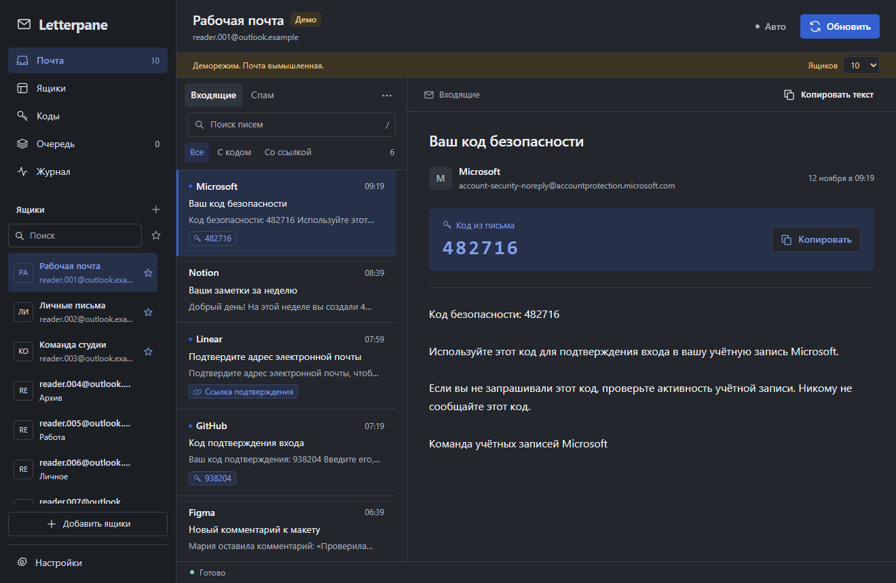

# Letterpane

[Русский](README.md) · English · [Українська](README.uk.md)

A Windows mail client for multiple Microsoft accounts, with messages and verification codes in one window. A local profile supports up to 500 accounts. This is a preview build; see [release checks and remaining work](RELEASE_CHECKLIST.md).

[Downloads](https://github.com/V1treus/letterpane/releases) · [Report a bug](https://github.com/V1treus/letterpane/issues/new/choose)



## Run

**Single file:** place `Letterpane Portable 1.3.9.exe` in a writable folder and open it. You do not need to install Python or Node.js.

**Folder version:** extract all of `Letterpane-1.3.9-win-x64.zip` and open `Letterpane.exe`.

Requires Windows 10/11 x64, .NET Framework 4.8 and [Microsoft Edge WebView2 Runtime](https://developer.microsoft.com/microsoft-edge/webview2/). The app uses the system WebView2 installation. The executable is currently unsigned.

The single EXE is about 37 MiB. On first launch it extracts components into `%TEMP%/LetterpanePortable/<hash>` and creates `Letterpane Portable.data` beside the EXE. Subsequent launches reuse the component cache. The profile needs write access to this folder.

Try the [demo](#demo-and-development) to explore the app with fictional accounts. To read mail, prepare the original TXT file with refresh tokens and their `client_id` values, then follow the [import steps](#import).

## Languages and appearance

Open **Settings → Appearance → Language** to choose Русский, English or Українська. Changes appear immediately. **Save** remembers the choice; **Cancel** restores the previous language. A new profile uses a supported Windows language, falling back to English. Existing profiles keep Russian until changed.

Navigation, settings, dialogs, errors, activity and startup windows are localized. Dates, sorting and plural forms follow the selected language. Mail content, account labels, groups and notes stay as entered. Language resources are bundled and work offline.

Six themes include System, Light, Dark, Paper, Midnight and Graphite. Choose an accent color, sidebar style, density and text size. Place the reader on the right, below the list or in a separate view. Resize panes by dragging their borders or using the settings sliders. Reader font and size are independent of the interface text.

Keyboard: `Ctrl+K` searches accounts, `/` searches messages, `Alt+1…5` switches sections and `Esc` returns or closes a dialog. Focused pane borders support arrow keys and Home. Settings tabs also support arrow keys.

## Accounts and mail

- Inbox and junk, search in loaded messages, copy codes, links and message text.
- Labels, groups, notes, favorites, filters and bulk actions.
- A table with 25, 50 or 100 rows per page; search runs across the whole profile before paging.
- Selection across pages, a count of selected accounts outside the filter and a bulk refresh report.
- A Codes section drawn from already loaded mail.
- One request queue, bounded retries and automatic refresh scoped to all active accounts, favorites or a group.
- Read-only access without changing the message's read status on the server.

## Import

Select **Add accounts**, paste a list or open a TXT file, then choose **Check** and **Add**. Maximum import size is 1 MiB. Supported line formats:

```text
email:refresh_token:client_id
email:password:refresh_token:client_id
email|refresh_token|client_id
email|password|refresh_token|client_id
email|password|refresh_token|client_id|recovery_email
```

The password and optional recovery email after `client_id` are ignored and never saved. Use the original `client_id` associated with the refresh token. Microsoft v2 is the default; choose Live if it is the mode specified for your token. The `M.` prefix alone does not identify the OAuth mode. Duplicates are skipped unless you explicitly enable replacement of existing tokens.

Obtaining the first refresh token through an OAuth sign-in is not implemented yet. Import requires a token you already have. Microsoft 365 must permit IMAP and the selected OAuth application. Use accounts you are authorized to access.

Copy tokens from the original TXT file or a code block: message formatting can hide `*` characters. Every token character matters; Letterpane does not reconstruct missing characters.

Importing, searching and switching accounts do not start provider requests. Select **Refresh** to fetch mail. Automatic refresh is off by default.

## Queue and provider limits

Only one IMAP session runs at a time per profile. Refresh starts are at least 5 seconds apart, or 60 seconds apart for the same account. You can increase these intervals. One pass across 500 accounts takes at least about 42 minutes. A manual refresh gives that account priority once its cooldown is over. Use favorites and groups to refresh a smaller set more frequently.

HTTP 429 honors `Retry-After`. IMAP throttling pauses the queue. Temporary failures allow up to three attempts with increasing delays; authentication failures stop retries until credentials are replaced or a manual access check succeeds. Cooldowns and authentication blocks survive a restart.

The OAuth or IMAP denial reason also survives a restart. Older blocks without a recorded reason show a general access-denied message.

After a bulk refresh, open **Refresh report** from the account list or go to **Queue**. The report lists updated, waiting, skipped and failed accounts. **Cancel waiting jobs** applies to the latest run: a request already sent may finish, but its retry is cancelled. The report is kept until Letterpane closes.

[See the bulk refresh report](docs/images/batch-report.png).

After fixing mail permissions, select **Check access** in the denial message or account card. This makes one attempt with the saved credentials, reads up to five messages and honors all cooldowns. Success clears the authentication block; failure, cancellation or restart keeps it in place. The check does not resume a paused queue or remove the account's manual pause. If you need new sign-in details, select **Replace credentials** to open import with the original OAuth mode and token replacement enabled.

[See access recovery in the account card](docs/images/access-recovery.png).

These measures reduce unnecessary traffic. They cannot guarantee that Microsoft will never restrict an account: provider limits and organization policies still apply.

## Local data

Tokens, addresses, settings and account metadata are encrypted with AES-256-GCM. Windows DPAPI CurrentUser protects the key. Access tokens, messages and activity remain in process memory; refresh-token rotations are saved.

Single-EXE profile: `Letterpane Portable.data/profile`. Folder-version profile: `.data/profile`. Separate `ui-language` and `ui-theme` files contain only the language code and theme name, allowing startup windows to match your preferences before the encrypted profile opens. Older profiles get the theme hint on their first launch of this version; subsequent launches use it from the start.

Back up `key.dpapi` and `accounts.vault` together while the app is closed. The key is tied to the original Windows account. Moving the EXE and profile to a different computer or Windows account requires importing tokens again. To upgrade, close the old version and put the Letterpane EXE next to it. Letterpane opens the existing `Posta Portable.data` folder if present. If both profile folders exist, it uses `Letterpane Portable.data`.

Messages are shown as inert text. Remote images, HTML, attachments and trackers are not executed. Large messages are limited to the first 512 KiB. Encryption does not protect against software running as your Windows user or access to process memory.

## Demo and development

Run `Letterpane Demo.exe` in the folder version, or:

```powershell
& '.\Letterpane Portable 1.3.9.exe' --demo
```

Choose 10, 100 or 500 fictional accounts. No requests go to Microsoft and real tokens are rejected. Demo changes are discarded when closed. The sample mail remains in its original language when switching the interface language.

Tests require Windows x64 and Node.js 22+. Release builds require the exact Node.js version in `.node-version` (24.21.0) and the .NET Framework compiler. Visual Studio is not required.

```powershell
npm ci --ignore-scripts
npm run check
npm test
npm run build
npm run demo
npm run build:single
```

Outputs are `dist/Letterpane 1.3.9` and `dist/Letterpane Portable 1.3.9.exe`. To create a ZIP, run `powershell.exe -NoProfile -ExecutionPolicy Bypass -File scripts/build.ps1 -Zip`. The first build downloads the WebView2 SDK from official NuGet. Previous release files are preserved; user profiles are excluded from the package.

Source folders: `src/` for mail, queue and storage; `public/` for the interface; `shared/locales/` for translations; `native/` for the Windows host and packaging; `test/` for offline tests with fictional data. See [contributing and translation guidance](CONTRIBUTING.md) and [third-party notices](THIRD-PARTY-NOTICES.md).

Run `npm run check:source` before staging source files. After building both distributions, run `npm run verify:release` to check the ZIP and embedded EXE payload and generate SHA256SUMS. `npm run smoke:release` exercises the packaged service with an isolated fictional profile. Component versions and file hashes are included in the package; these checks are not a publisher signature.

See [support](SUPPORT.md), [private security reporting](SECURITY.md) and the [manual QA matrix](docs/TESTING.md). The Letterpane source code does not have a project license yet.
