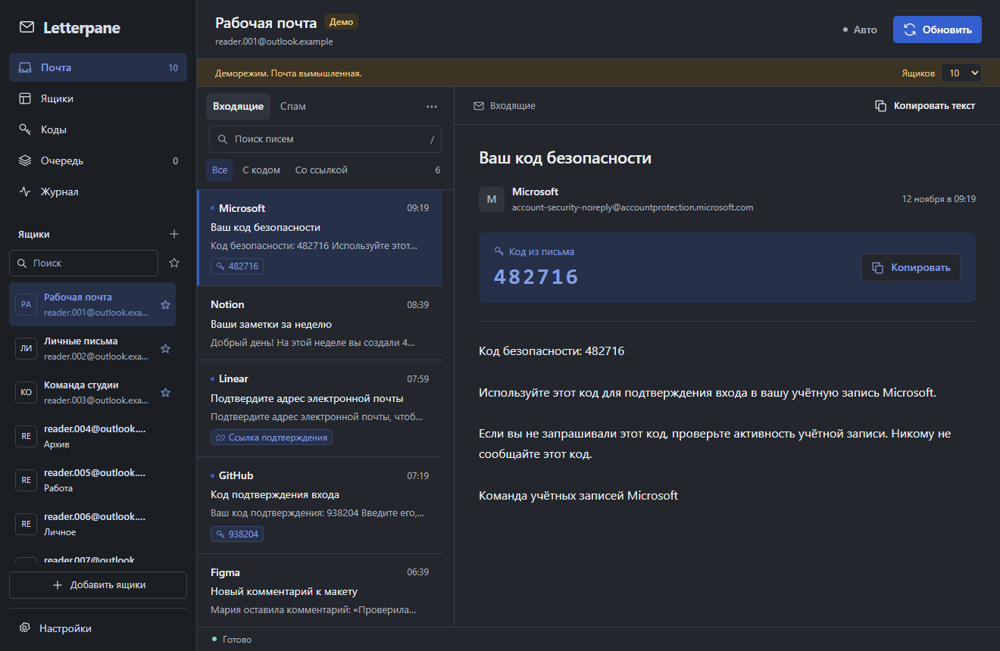
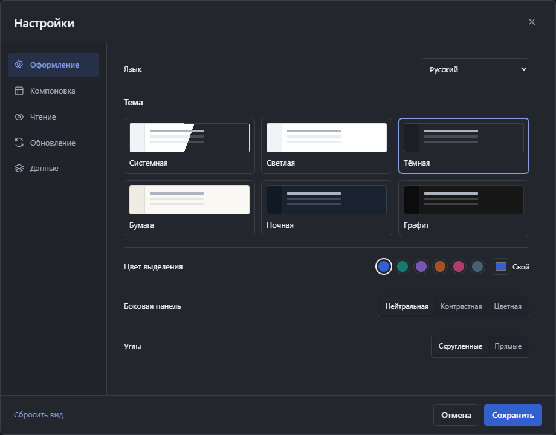
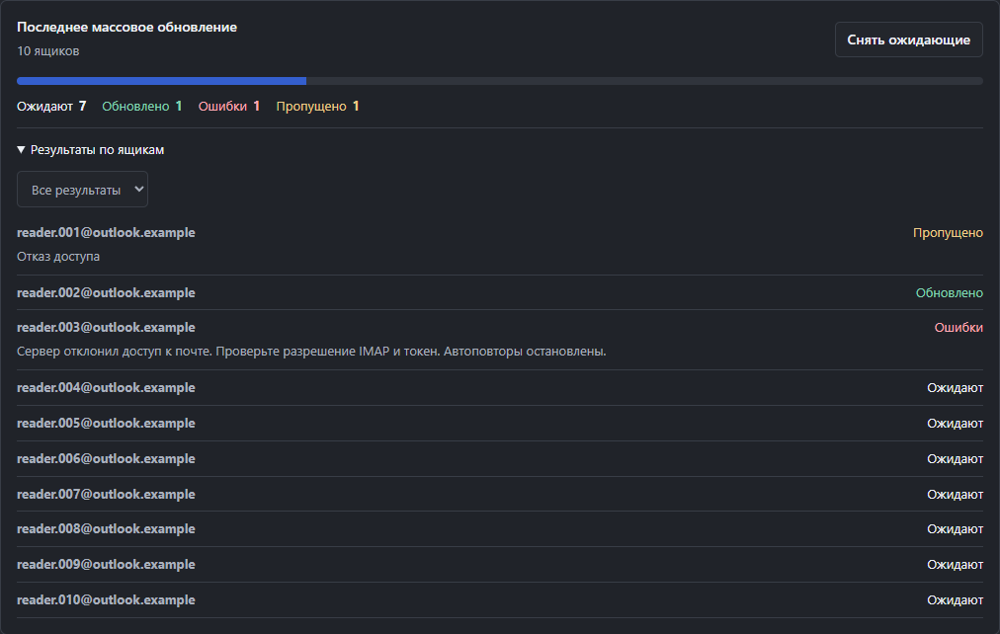
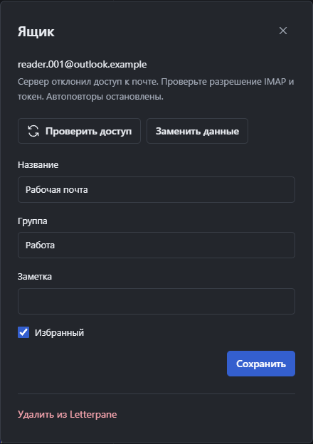

# Letterpane

Русский · [English](README.en.md) · [Українська](README.uk.md)

Почтовый клиент для Windows: несколько Microsoft-ящиков, письма и коды подтверждения в одном окне. До 500 ящиков в локальном профиле.

[Загрузки](https://github.com/V1treus/letterpane/releases) · [Сообщить об ошибке](https://github.com/V1treus/letterpane/issues/new/choose)



## Запуск

**Один файл:** скачайте или соберите `Letterpane Portable 1.3.9.exe`, поместите в доступную для записи папку и запустите. Python и Node.js устанавливать не нужно.

**Версия с папкой:** распакуйте весь `Letterpane-1.3.9-win-x64.zip` и откройте `Letterpane.exe`.

Требования: Windows 10/11 x64, .NET Framework 4.8 и [Microsoft Edge WebView2 Runtime](https://developer.microsoft.com/microsoft-edge/webview2/). Сборка использует системный WebView2. EXE пока не подписан сертификатом издателя.

Один EXE занимает около 37 МБ. При первом запуске он извлекает компоненты в `%TEMP%/LetterpanePortable/<хэш>`; профиль создаётся рядом с EXE в `Letterpane Portable.data`. Подробности — [PORTABLE.md](PORTABLE.md).

Для первого знакомства запустите [демо](#демо) с вымышленными ящиками. Для работы с почтой подготовьте исходный TXT с refresh-токенами и `client_id`, затем следуйте шагам [импорта](#импорт).

## Возможности

- Входящие и спам, поиск по загруженным письмам, копирование кодов, ссылок и текста.
- Названия ящиков, группы, заметки, избранное, фильтры и массовые действия.
- Таблица на 25, 50 или 100 строк; поиск по всему профилю до разбиения на страницы.
- Выделение ящиков на нескольких страницах, счётчик выбранных вне фильтра и отчёт массового обновления.
- Отдельный раздел с кодами из уже загруженной почты.
- Одна очередь запросов с паузами и ограниченным числом повторов.
- Автообновление всех активных ящиков, избранного или отдельной группы.
- Письма открываются только для чтения, без изменения статуса на сервере.

## Настройка интерфейса

Язык меняется в **Настройки → Оформление → Язык**: русский, English и українська. Перевод применяется сразу; «Сохранить» запоминает выбор, «Отмена» возвращает прежний язык. Переведены навигация, настройки, диалоги, сообщения об ошибках, журнал и окна запуска. Даты и формы количества учитывают язык. Содержимое писем, названия ящиков и заметки остаются в исходном виде.

Новый профиль использует поддерживаемый язык Windows, иначе английский. Прежний профиль сохраняет русский до смены языка в настройках.



- Системная, светлая, тёмная, «Бумага», «Ночная» и «Графит» темы.
- Цвет выделения из палитры или свой; нейтральная, контрастная или цветная боковая панель.
- Три плотности и готовые размеры текста.
- Письмо справа, снизу или в отдельном представлении с возвратом к списку.
- Ширина панелей и высота нижнего списка меняются перетягиванием границ или ползунками.
- Отдельные шрифт и размер текста письма, число строк превью, аватары и коды в списке.
- Предпросмотр изменений до сохранения; «Отмена» возвращает сохранённый вид.

Границы панелей также доступны с клавиатуры: стрелки меняют размер, Home сбрасывает его. Вкладки настроек переключаются стрелками. `Ctrl+K` — поиск ящиков, `/` — поиск писем, `Alt+1…5` — разделы, `Esc` — назад или закрытие диалога.

## Импорт

Нажмите «Добавить ящики», вставьте список или откройте TXT-файл, затем «Проверить» и «Добавить». До 1 МБ за импорт.

```text
email:refresh_token:client_id
email:password:refresh_token:client_id
email|refresh_token|client_id
email|password|refresh_token|client_id
email|password|refresh_token|client_id|recovery_email
```

Пароль и необязательная резервная почта после `client_id` игнорируются и не сохраняются. Нужен исходный `client_id`, которому выдан токен. По умолчанию используется Microsoft v2; выбирайте Live, если этот режим указан для токена. Префикс `M.` сам по себе не определяет режим OAuth. Дубликаты пропускаются; замена токенов включается отдельным флажком.

Получение первого refresh-токена через OAuth-вход пока не реализовано: импортируется уже выданный токен. Microsoft 365 должен разрешать IMAP и выбранное OAuth-приложение. Используйте ящики, к которым у вас есть разрешённый доступ.

Копируйте токены из исходного TXT или блока кода: форматирование сообщений может скрыть символы `*`. Все символы токена значимы; Letterpane не восстанавливает потерянные символы.

Импорт, поиск и переключение между ящиками не начинают сетевых запросов. Для загрузки писем нажмите «Обновить». Автообновление по умолчанию выключено.

## Очередь и ограничения

Один активный IMAP-сеанс на профиль. Между стартами обновления проходит минимум 5 секунд, для одного ящика — минимум 60 секунд. Настройки позволяют увеличить интервалы. Один проход по 500 ящикам занимает от 42 минут. Ручное обновление поднимает ящик в очередь перед фоновыми задачами с учётом пауз. Для частого обновления части ящиков используйте избранное и группы.

HTTP 429 учитывает `Retry-After`; ограничение IMAP приостанавливает очередь. Временная ошибка даёт до трёх попыток с увеличением паузы. Ошибка доступа останавливает повторы до замены данных или успешной ручной проверки. Ожидание и блокировка авторизации сохраняются после перезапуска.

Причина отказа OAuth или IMAP также сохраняется после перезапуска. Для старой блокировки без записанной причины показывается общий отказ доступа.

После массового обновления откройте **Отчёт обновления** в списке ящиков или раздел **Очередь**. Видно, какие ящики обновились, ждут, пропущены или завершились ошибкой. Кнопка **Снять ожидающие** относится только к последнему запуску: начатый запрос может завершиться, его повтор отменяется. Отчёт хранится до закрытия Letterpane.



После исправления разрешений почты нажмите **Проверить доступ** в сообщении об отказе или карточке ящика. Это одна попытка с сохранёнными данными, с чтением до пяти писем и соблюдением всех пауз. Успех снимает блокировку; ошибка, отмена или перезапуск оставляют её включённой. Проверка не снимает общую паузу очереди и не отменяет ручную паузу ящика. Если нужны новые данные входа, нажмите **Заменить данные**: откроется импорт с исходным режимом OAuth и включённой заменой токенов.



Эти меры уменьшают лишнюю нагрузку. Отсутствие блокировок Microsoft не гарантируется: действуют ограничения провайдера и политики организации.

## Данные

- Токены, адреса, настройки и сведения о ящиках зашифрованы AES-256-GCM. Ключ защищён Windows DPAPI CurrentUser.
- Access-токены, письма и журнал остаются в памяти процесса. Refresh-токены сохраняются при ротации.
- Профиль одного EXE: `Letterpane Portable.data/profile`. Профиль версии с папкой: `.data/profile`.
- Рядом с профилем хранятся код языка в `ui-language` и название темы в `ui-theme`, чтобы сразу оформить окно запуска. Токенов и адресов в этих файлах нет. Старые профили получают файл темы при первом запуске новой версии; последующие запуски используют его с самого начала.
- Для резервной копии сохраняйте вместе `key.dpapi` и `accounts.vault`. На другом компьютере или под другим пользователем Windows токены нужно импортировать заново.
- Для обновления положите Letterpane рядом со старым EXE. Если там есть `Posta Portable.data`, Letterpane прочитает этот профиль. При наличии обеих папок используется `Letterpane Portable.data`. Перед обновлением закройте старую версию и сохраните резервную копию профиля.

Письмо выводится текстом: внешние изображения, HTML, вложения и трекеры не исполняются. Большие письма ограничены первыми 512 КБ. Шифрование не защищает от программы, работающей под вашей учётной записью, или от доступа к памяти процесса.

## Демо

```powershell
& '.\Letterpane Portable 1.3.9.exe' --demo
```

В версии с папкой можно запустить `Letterpane Demo.exe`. Доступны 10, 100 и 500 вымышленных ящиков. Обращений к Microsoft нет; настоящие токены не принимаются. Изменения деморежима исчезают после закрытия.

## Разработка

Нужны Windows x64 и встроенный компилятор .NET Framework. Для тестов подходит Node.js 22+, для релизной сборки используется точная версия из `.node-version` (24.21.0). Visual Studio не требуется.

```powershell
npm ci --ignore-scripts
npm run check
npm test
npm run build
npm run demo
npm run build:single
```

Сборки: `dist/Letterpane 1.3.9` и `dist/Letterpane Portable 1.3.9.exe`. Для архива: `powershell.exe -NoProfile -ExecutionPolicy Bypass -File scripts/build.ps1 -Zip`. При первой сборке SDK WebView2 скачивается из официального NuGet. Предыдущие версии сборщик не перезаписывает. Пользовательские профили не включаются в поставку.

`src/` — почта, очередь, настройки и хранилище; `public/` — интерфейс; `shared/locales/` — переводы; `native/` — окно Windows и упаковка; `test/` — автономные тесты с вымышленными данными. Изменения — в [CHANGELOG.md](CHANGELOG.md), правила интерфейса — в [DESIGN.md](DESIGN.md), работа с исходниками — в [CONTRIBUTING.md](CONTRIBUTING.md).

`npm run check:source` проверяет состав исходников и известные форматы секретов. После сборки обеих поставок `npm run verify:release` проверяет ZIP и встроенный пакет EXE и создаёт SHA256SUMS; `npm run smoke:release` проверяет готовую службу с отдельным вымышленным профилем. Версии компонентов и хеши файлов включены в пакет. Эти проверки не заменяют подпись издателя.

Правила поддержки и сообщений об уязвимостях описаны в [SUPPORT.md](SUPPORT.md) и [SECURITY.md](SECURITY.md). Лицензия для исходного кода Letterpane пока не выбрана.

Текущая сборка — предварительная. Проверки перед публичным релизом и оставшиеся ограничения перечислены в [RELEASE_CHECKLIST.md](RELEASE_CHECKLIST.md).

## Документация зависимостей

[OAuth для IMAP](https://learn.microsoft.com/en-us/exchange/client-developer/legacy-protocols/how-to-authenticate-an-imap-pop-smtp-application-by-using-oauth), [ротация refresh-токенов](https://learn.microsoft.com/en-us/entra/identity-platform/refresh-tokens), [WebView2](https://learn.microsoft.com/en-us/microsoft-edge/webview2/get-started/winforms), [ImapFlow](https://imapflow.com/docs/api/imapflow-client/). Лицензии зависимостей: [THIRD-PARTY-NOTICES.md](THIRD-PARTY-NOTICES.md).
