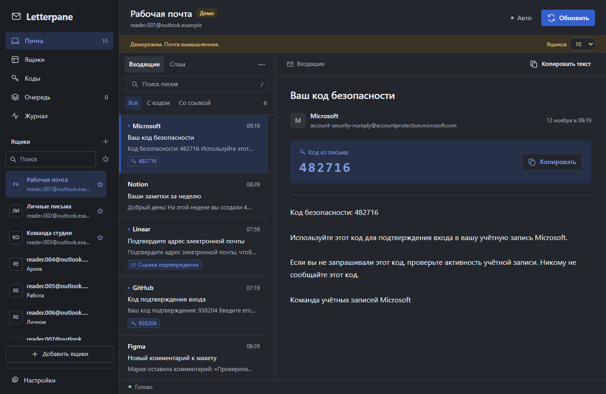

# Letterpane

[Русский](README.md) · [English](README.en.md) · Українська

Поштовий клієнт для Windows: кілька скриньок Microsoft, листи й коди підтвердження в одному вікні. До 500 скриньок у локальному профілі. Це попередня збірка; перевірки та незавершені завдання наведено в [RELEASE_CHECKLIST.md](RELEASE_CHECKLIST.md).

[Завантаження](https://github.com/V1treus/letterpane/releases) · [Повідомити про помилку](https://github.com/V1treus/letterpane/issues/new/choose)



## Запуск

**Один файл:** покладіть `Letterpane Portable 1.3.9.exe` у папку з дозволом на запис і запустіть. Установлювати Python або Node.js не потрібно.

**Версія з папкою:** повністю розпакуйте `Letterpane-1.3.9-win-x64.zip` і відкрийте `Letterpane.exe`.

Потрібні Windows 10/11 x64, .NET Framework 4.8 та [Microsoft Edge WebView2 Runtime](https://developer.microsoft.com/microsoft-edge/webview2/). Застосунок використовує системний WebView2. EXE наразі не підписано сертифікатом видавця.

Один EXE займає близько 37 МіБ. Під час першого запуску компоненти розпаковуються в `%TEMP%/LetterpanePortable/<хеш>`, а поруч з EXE створюється `Letterpane Portable.data`. Наступні запуски використовують готовий кеш компонентів. Для профілю потрібен дозвіл на запис у цю папку.

Для першого знайомства запустіть [демонстрацію](#демонстрація-й-розробка) з вигаданими скриньками. Для читання пошти підготуйте початковий TXT із refresh-токенами та їхніми `client_id`, а далі виконайте [кроки імпорту](#імпорт).

## Мови й оформлення

Відкрийте **Налаштування → Оформлення → Мова** та виберіть Русский, English або Українська. Зміни видно одразу. **Зберегти** запам’ятовує вибір, **Скасувати** повертає попередню мову. Новий профіль використовує підтримувану мову Windows, інакше англійську. Старі профілі зберігають російську до зміни в налаштуваннях.

Перекладено навігацію, налаштування, діалоги, помилки, журнал і вікна запуску. Дати, сортування та форми кількості враховують вибрану мову. Вміст листів, назви скриньок, групи й нотатки залишаються в початковому вигляді. Усі переклади входять до збірки й працюють без інтернету.

Доступні системна, світла, темна, «Папір», «Нічна» та «Графіт» теми. Можна вибрати колір виділення, вигляд бічної панелі, щільність і розмір тексту. Область читання розміщується праворуч, знизу або окремо. Розміри панелей змінюються перетягуванням меж або повзунками. Шрифт і розмір тексту листа налаштовуються незалежно від інтерфейсу.

Клавіатура: `Ctrl+K` — пошук скриньок, `/` — пошук листів, `Alt+1…5` — розділи, `Esc` — назад або закриття діалогу. Межі панелей у фокусі підтримують стрілки й Home. Вкладки налаштувань також перемикаються стрілками.

## Скриньки й листи

- Вхідні та спам, пошук у завантажених листах, копіювання кодів, посилань і тексту.
- Назви, групи, нотатки, обране, фільтри та масові дії.
- Таблиця по 25, 50 або 100 рядків; пошук охоплює весь профіль до поділу на сторінки.
- Вибір скриньок на кількох сторінках, лічильник вибраних поза фільтром і звіт про масове оновлення.
- Окремий розділ кодів із уже завантаженої пошти.
- Одна черга запитів, обмежені повтори й автооновлення всіх активних скриньок, обраного або окремої групи.
- Лише читання без зміни позначки прочитання на сервері.

## Імпорт

Натисніть **Додати скриньки**, вставте список або відкрийте TXT-файл, далі **Перевірити** й **Додати**. До 1 МіБ за імпорт. Формати рядків:

```text
email:refresh_token:client_id
email:password:refresh_token:client_id
email|refresh_token|client_id
email|password|refresh_token|client_id
email|password|refresh_token|client_id|recovery_email
```

Пароль і необов’язкова резервна пошта після `client_id` ігноруються й не зберігаються. Потрібен початковий `client_id`, якому видано refresh-токен. Типово використовується Microsoft v2; вибирайте Live, якщо для токена вказано цей режим. Сам префікс `M.` не визначає режим OAuth. Дублікати пропускаються; заміна наявних токенів вмикається окремим прапорцем.

Отримання першого refresh-токена через OAuth-вхід поки не реалізовано: імпортується вже виданий токен. Microsoft 365 має дозволяти IMAP і вибраний OAuth-застосунок. Використовуйте скриньки, до яких маєте дозволений доступ.

Копіюйте токени з початкового TXT-файлу або блоку коду: форматування повідомлень може приховати символи `*`. Кожен символ токена має значення; Letterpane не відновлює втрачені символи.

Імпорт, пошук і перемикання скриньок не запускають запитів до провайдера. Щоб завантажити листи, натисніть **Оновити**. Автооновлення спочатку вимкнено.

## Черга й обмеження

На профіль працює одне IMAP-з’єднання одночасно. Між запусками оновлення минає щонайменше 5 секунд, для тієї самої скриньки — щонайменше 60 секунд. Інтервали можна збільшити. Один прохід по 500 скриньках триває від 42 хвилин. Ручне оновлення дає скриньці пріоритет у черзі з урахуванням пауз. Для частішого оновлення частини скриньок використовуйте обране й групи.

HTTP 429 враховує `Retry-After`. Обмеження IMAP призупиняє чергу. Тимчасова помилка допускає до трьох спроб зі збільшенням паузи; помилка доступу зупиняє повтори до заміни даних або успішної ручної перевірки. Очікування та блокування авторизації зберігаються після перезапуску.

Причина відмови OAuth або IMAP також зберігається після перезапуску. Для старого блокування без записаної причини відображається загальна відмова доступу.

Після масового оновлення відкрийте **Звіт про оновлення** зі списку скриньок або перейдіть до **Черги**. Звіт показує оновлені скриньки, ті, що очікують, пропущені й ті, де сталася помилка. **Скасувати очікування** стосується лише останнього запуску: надісланий запит може завершитися, але його повтор скасовується. Звіт зберігається до закриття Letterpane.

[Переглянути звіт про масове оновлення](docs/images/batch-report.png).

Після виправлення дозволів пошти натисніть **Перевірити доступ** у повідомленні про відмову або картці скриньки. Це одна спроба зі збереженими даними, читанням до п’яти листів і дотриманням усіх пауз. Успіх знімає блокування; помилка, скасування або перезапуск залишають його ввімкненим. Перевірка не відновлює призупинену чергу й не скасовує ручну паузу скриньки. Якщо потрібні нові дані входу, натисніть **Замінити дані**: відкриється імпорт із початковим режимом OAuth та ввімкненою заміною токенів.

[Відновлення доступу в картці скриньки](docs/images/access-recovery.png).

Ці заходи зменшують зайве навантаження. Вони не гарантують відсутності обмежень Microsoft: діють ліміти провайдера й політики організації.

## Локальні дані

Токени, адреси, налаштування та відомості про скриньки зашифровано AES-256-GCM. Ключ захищено Windows DPAPI CurrentUser. Access-токени, листи й журнал залишаються в пам’яті процесу; оновлені refresh-токени зберігаються.

Профіль одного EXE: `Letterpane Portable.data/profile`. Профіль версії з папкою: `.data/profile`. Окремі файли `ui-language` та `ui-theme` містять лише код мови й назву теми, щоб одразу оформити вікно запуску до відкриття зашифрованого профілю. Старі профілі отримують файл теми під час першого запуску цієї версії; наступні запуски використовують його від самого початку.

Для резервної копії зберігайте `key.dpapi` та `accounts.vault` разом, коли застосунок закрито. Ключ прив’язано до початкового користувача Windows. На іншому комп’ютері або під іншим обліковим записом токени потрібно імпортувати знову. Для оновлення закрийте стару версію й покладіть Letterpane поруч із попереднім EXE. Letterpane відкриє наявну папку `Posta Portable.data`. Якщо є обидві папки профілю, застосунок використає `Letterpane Portable.data`.

Лист відображається як текст: зовнішні зображення, HTML, вкладення й трекери не виконуються. Великі листи обмежено першими 512 КіБ. Шифрування не захищає від програми, що працює під вашим користувачем Windows, або від доступу до пам’яті процесу.

## Демонстрація й розробка

Відкрийте `Letterpane Demo.exe` у версії з папкою або виконайте:

```powershell
& '.\Letterpane Portable 1.3.9.exe' --demo
```

Доступні 10, 100 і 500 вигаданих скриньок. Запитів до Microsoft немає, справжні токени не приймаються. Зміни зникають після закриття. Приклад листування зберігає свою початкову мову після перемикання інтерфейсу.

Для тестів потрібні Windows x64 та Node.js 22+. Для релізної збірки — точна версія Node.js із `.node-version` (24.21.0) і компілятор .NET Framework. Visual Studio не потрібна.

```powershell
npm ci --ignore-scripts
npm run check
npm test
npm run build
npm run demo
npm run build:single
```

Результат: `dist/Letterpane 1.3.9` та `dist/Letterpane Portable 1.3.9.exe`. Для ZIP: `powershell.exe -NoProfile -ExecutionPolicy Bypass -File scripts/build.ps1 -Zip`. Перша збірка завантажує SDK WebView2 з офіційного NuGet. Старі збірки зберігаються, профілі користувача не входять до пакета.

Каталоги: `src/` — пошта, черга й сховище; `public/` — інтерфейс; `shared/locales/` — переклади; `native/` — вікно Windows і пакування; `test/` — автономні тести з вигаданими даними. Дивіться [правила внесків і перекладів](CONTRIBUTING.md) та [ліцензії залежностей](THIRD-PARTY-NOTICES.md).

Перед додаванням файлів у Git виконайте `npm run check:source`. Після збірки обох пакетів `npm run verify:release` перевіряє ZIP і вбудований пакет EXE та створює SHA256SUMS. `npm run smoke:release` перевіряє готову службу з окремим вигаданим профілем. Версії компонентів і хеші файлів входять до пакета; ці перевірки не замінюють підпис видавця.

Дивіться [підтримку](SUPPORT.md), [приватні повідомлення про вразливості](SECURITY.md) та [матрицю ручних перевірок](docs/TESTING.md). Ліцензію для вихідного коду Letterpane ще не вибрано.
